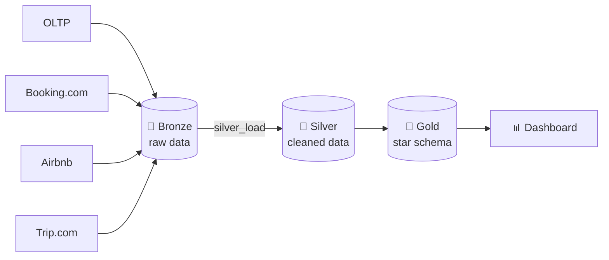
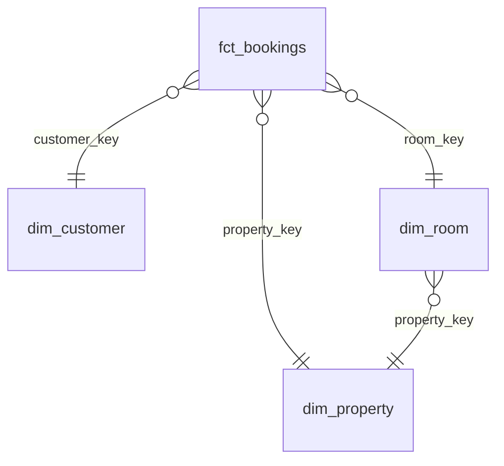

<h1 align="center">🏨 Hotel Bookings Data Warehouse</h1>

<p align="center">
  A Snowflake data warehouse that unifies hotel bookings from an internal OLTP system and three third-party channels into one analytics-ready model.
</p>

<p align="center">
  
  
  
  
</p>

---

## 📌 Overview

Bookings arrive from four different systems, each with its own structure and data quality issues. This project cleans, standardizes, and models them so analysts can answer business questions from a single source of truth.

**Data sources**

| Source | Type | Content |
|---|---|---|
| OLTP | Internal | Bookings, customers, promotions, payments, properties, room types, rooms |
| Booking.com | Third party | Bookings with customer details |
| Airbnb | Third party | Bookings with basic customer info |
| Trip.com | Third party | Bookings with basic customer info |

## 🏗️ Architecture

The project follows a **medallion architecture** in the `dwh_hotel_bookings` database.



| Layer | Schema | Purpose |
|---|---|---|
| 🥉 Bronze | `bronze` | Raw data exactly as received from each source |
| 🥈 Silver | `silver` | Cleaned and standardized tables, loaded by the `silver_load()` stored procedure |
| 🥇 Gold | `gold` | Star schema (dimensions and fact view) for reporting |

## ⚙️ Requirements

### Data quality (Silver layer)

- Trim all text fields and standardize casing (`INITCAP`, `LOWER`)
- Safely convert dates (`TRY_TO_DATE`) and numbers
- Fix negative, malformed, and outlier amounts
- Standardize payment providers and room number formats
- Swap check-in/check-out dates when reversed, and recompute nights when inconsistent
- Run the full load in a single transaction, with success and failure logging in `silver.etl_log`

### Modeling (Gold layer)

- **Deterministic surrogate keys** using `MD5(source_system || '|' || source_id)`, because third-party sources have no customer ID
- **`dim_customer`**: union of all four sources, one row per source record (no cross-source matching)
- **`dim_property`**: built from `oltp_properties`, since all sources share the same property IDs
- **`dim_room`**: keyed on `property_id | room_number`, the grain every source can compute
- **`fct_bookings`**: union of all four booking sources, using identical key formulas as the dimensions



## 📦 Deliverables

### 1. SQL scripts

- `silver_load()` stored procedure (cleaning and logging)
- Gold views: `dim_customer`, `dim_property`, `dim_room`, `fct_bookings`

### 2. Business analysis

5 SQL queries covering:

- Revenue trends
- Top properties
- Channel mix
- Length of stay
- Cancellations and promotions

### 3. Dashboard

2 charts and 3 KPIs:

- 📈 Monthly revenue trend (line)
- 📊 Top 5 properties by revenue (horizontal bar)

## 🚀 Getting Started

```sql
-- 1. Load bronze data into the bronze schema
-- 2. Run the silver load
USE DATABASE dwh_hotel_bookings;
USE SCHEMA silver;
CALL silver_load();

-- 3. Check the run log
SELECT * FROM silver.etl_log ORDER BY started_at DESC;

-- 4. Create the gold views, then query them
SELECT * FROM gold.fct_bookings LIMIT 10;
```

## 🛠️ Tech Stack

- **Snowflake** (Snowflake Scripting, stored procedures, views)
- **SQL**
- **BI tool** for the dashboard
